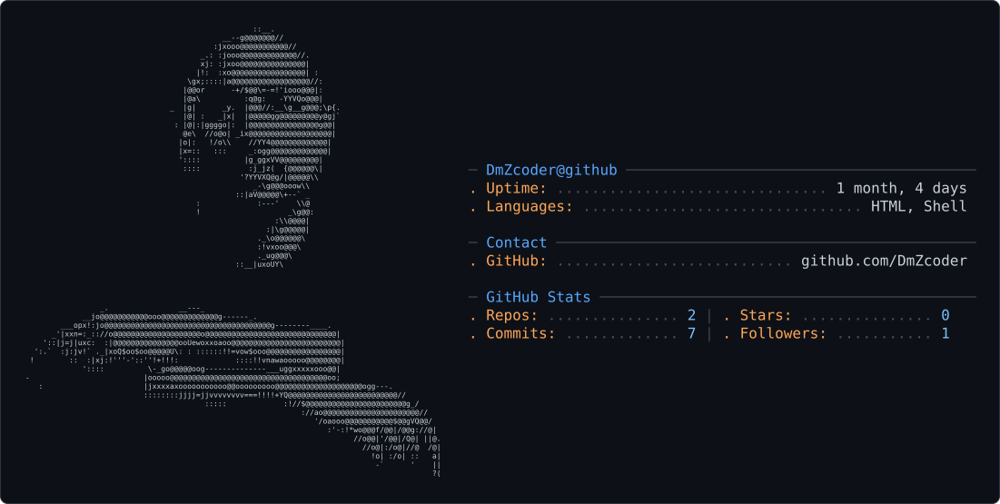

<!-- Animated Header -->

  

<!-- Dark / Light Mode Banner --><picture>
  <source media="(prefers-color-scheme: dark)" srcset="dark_mode_dmz.svg" />
  <source media="(prefers-color-scheme: light)" srcset="light_mode_dmz.svg" />
  
</picture><h1 align="center">👋 Hi there, I'm Wasi AL</h1><h3 align="center">
  🐍 Python Developer | 🐧 Linux Enthusiast | 📱 Termux Tool Creator
</h3>

  Passionate about coding, Linux, terminal customization, and building useful tools.

  
  
  

---

🚀 About Me

- 🐍 Python developer passionate about building useful tools.
- 🐧 Linux enthusiast who enjoys terminal-based workflows.
- 📱 Creator of tools and projects for Termux.
- 💻 Interested in open-source software and automation.
- 💡 Always exploring new technologies and solving problems.

---

🛠️ Skills & Technologies

  

  
  
  

---

📂 Featured Project

🖥️ Wasi_aL_OS v1.6

  
  
  

Wasi_aL_OS is a colorful, terminal-based mini operating system simulation designed for Termux.

Features:

- 🎨 Colorful terminal interface.
- ⚡ Python-based terminal experience.
- 📱 Designed for Termux users.
- 🧰 Lightweight command-line project.

  

---

📦 Installation Guide

Choose how you want to use WASI AL OS.

🖥️ Option 1: Run the Terminal Version

Open Termux and execute these commands one by one:

pkg update -y
pkg install git python -y
git clone https://github.com/WasiaL007/Wasi_aL_OS-Linux.git
cd Wasi_aL_OS-Linux
python run.py

📱 Option 2: Install the Android APK

pkg update -y
pkg install git -y
git clone https://github.com/WasiaL007/Wasi_aL_OS-Linux.git
cd Wasi_aL_OS-Linux
bash install.sh

Follow any on-screen instructions to complete the installation.

⚡ Quick Run

If the project is already installed:

cd ~/Wasi_aL_OS-Linux && clear && python run.py

---

📊 GitHub Statistics

  

  

  

---

🏆 GitHub Achievements

  

---

🌐 Connect With Me

  

- 🐙 GitHub: "@WasiaL007" (https://github.com/WasiaL007)
- 💻 Main Project: "Wasi_aL_OS-Linux" (https://github.com/WasiaL007/Wasi_aL_OS-Linux)

---

⭐ Support My Work

If you enjoy WASI AL OS or find my projects useful:

- ⭐ Star the repository.
- 🍴 Fork the project.
- 🐛 Report issues through the repository's Issues tab.
- 💡 Share ideas for future improvements.

Your support motivates me to keep building and improving open-source projects!

---

📜 License

WASI AL OS is described as being licensed under the MIT License. See the project's repository for the license file and terms.

---

  

<h3 align="center">✨ Code • Create • Innovate ✨</h3>

  Made with ❤️ by <b>Wasi AL</b>
   
  🐍 Python | 🐧 Linux | 📱 Termux

  ⭐ Thanks for visiting my GitHub profile! ⭐

